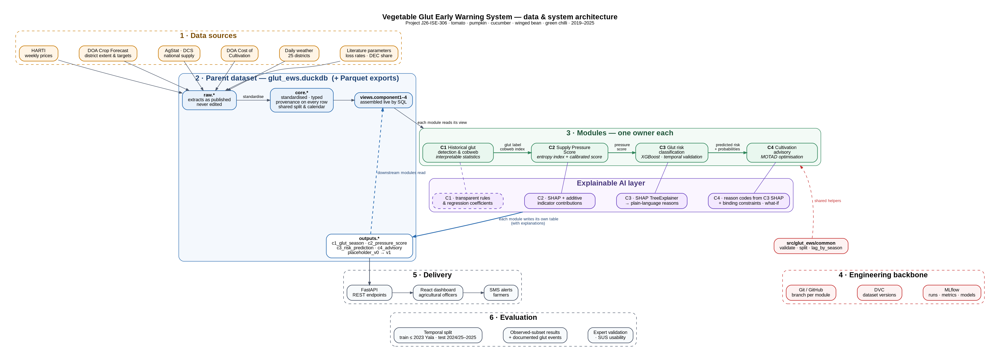
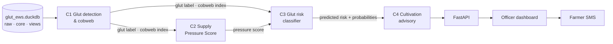
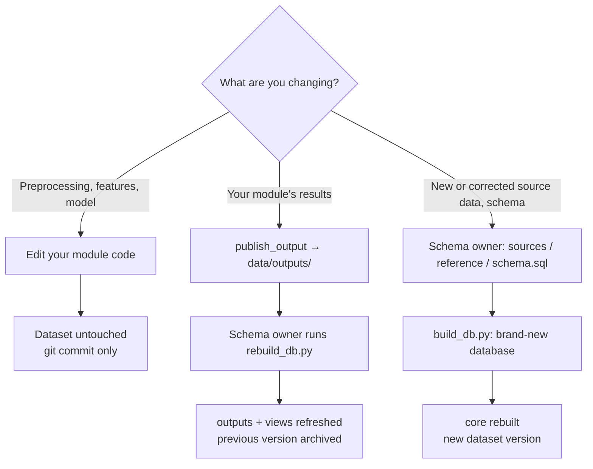

# glut-ews — Vegetable Glut Early Warning System for Sri Lankan Farmers

Research project **J26-ISE-306** · SLIIT Faculty of Computing

A machine-learning based early warning system that tells agricultural officers and farmers, **before the planting season begins**, which vegetable crops in which districts are likely to face a glut, and what they can grow instead.

| | |
|---|---|
| **Crops** | Tomato · Pumpkin · Cucumber · Winged bean · Green chilli |
| **Period** | 2018/19 Maha – 2025 Yala (weekly data 2019–2025) |
| **Coverage** | 12 economic centres · 12 producing districts (29 crop–district pairs) |
| **Dataset** | v1.2 (footprint-based regeneration) · tooling v1.2 |



---

## Contents

1. [Team and ownership](#1-team-and-ownership)
2. [System overview](#2-system-overview)
3. [Project structure](#3-project-structure)
4. [The parent dataset](#4-the-parent-dataset)
5. [Setup — macOS](#5-setup--macos)
6. [Setup — Windows](#6-setup--windows)
7. [VS Code setup](#7-vs-code-setup)
8. [Git and DVC setup (schema owner, once)](#8-git-and-dvc-setup-schema-owner-once)
9. [Daily workflow](#9-daily-workflow)
10. [Updating the parent dataset](#10-updating-the-parent-dataset)
11. [Rules everyone follows](#11-rules-everyone-follows)
12. [Component guides](#12-component-guides)
13. [Explainable AI](#13-explainable-ai)
14. [Starting outputs (v0) and replacement order](#14-starting-outputs-v0-and-replacement-order)
15. [Project phases](#15-project-phases)
16. [System integration](#16-system-integration)
17. [Publication checklist](#17-publication-checklist)
18. [Troubleshooting](#18-troubleshooting)
19. [Documentation reference](#19-documentation-reference)

---

## 1. Team and ownership

| Component | Owner | Reads | Writes |
|---|---|---|---|
| C1 · Historical Glut Detection & Cobweb Analysis | G S Perera (IT23368552) | `views.component1_dataset` | `outputs.c1_glut_season` |
| C2 · Supply Pressure Assessment | Peiris M S A (IT23364042) | `views.component2_dataset` | `outputs.c2_pressure_score` |
| C3 · Glut Risk Prediction & Classification | Kudagama K E D M (IT23246782) | `views.component3_dataset` | `outputs.c3_risk_prediction` |
| C4 · Displacement-Aware Cultivation Advisory | Fernando J E (IT23267268) | `views.component4_dataset` | `outputs.c4_advisory` |
| **Schema owner** (parent dataset & shared code) | *assign one person* | all | `core.*`, `src/glut_ews/common/`, `sql/views.sql`; runs `scripts/rebuild_db.py` |

Each owner is responsible for their module's preprocessing, model, explanations, evaluation and output table. Changes to `core.*`, `src/glut_ews/common/` or `sql/views.sql` go through the schema owner by pull request.

---

## 2. System overview

| | Component | Method | Explainability |
|---|---|---|---|
| **C1** | Historical glut detection & cobweb analysis | Anomaly + change-point detection, Nerlove supply response | Interpretable by design |
| **C2** | Supply Pressure Score | Entropy-weighted composite index + calibrated score | SHAP + additive contributions |
| **C3** | Glut risk classification | XGBoost, temporal validation | SHAP TreeExplainer → plain-language reasons |
| **C4** | Displacement-aware cultivation advisory | MOTAD optimisation | Reason codes + binding constraints + what-if |



---

## 3. Project structure

```
glut-ews/
├── data/
│   ├── glut_ews.duckdb          parent dataset (DVC-tracked)
│   ├── config/crop_district_footprint.csv   which districts grow which crop (core / proposed + evidence)
│   ├── raw/source_manifest.csv  source files + SHA-256 fingerprints
│   ├── raw/sources/             original source files incl. WFP and DCS price CSVs (DVC-tracked)
│   ├── raw/extracts/            source extracts as published, Parquet (DVC-tracked; build input)
│   ├── reference/               curated reference tables, CSV (Git; build input)
│   ├── outputs/                 module outputs waiting to be loaded (publish_output writes here)
│   └── backups/                 automatic database backups (local only, last 3)
├── parquet/                     read-only exports of every table (regenerated by the rebuild)
├── sql/views.sql                view definitions (edit here, never in the database)
├── sql/schema.sql               table definitions (types, primary keys) for a brand-new database
├── scripts/
│   ├── build_db.py              builds the whole database from scratch (raw → reference → generate → views → checks → exports)
│   ├── rebuild_db.py            applies published module outputs, re-applies views, checks, exports
│   └── validate_dataset.py      writes docs/validation_summary.md, refreshes the data dictionary
├── src/glut_ews/
│   ├── common/                  db access · validation · split · lag · output contracts · publish
│   ├── build/generator.py       generation of modelled tables and v0 outputs (seed 20261018)
│   ├── c1_glut_cobweb/          C1 module code
│   ├── c2_pressure/             C2 module code
│   ├── c3_risk/                 C3 module code
│   └── c4_advisory/             C4 module code
├── notebooks/                   c1_01_eda.ipynb … c4_01_eda.ipynb (starter notebooks)
├── tests/                       keys, split, no look-ahead, publish → rebuild loop
├── docs/                        architecture · datasheet · data dictionary · known issues · reports
├── api/                         FastAPI service (to be built)
├── dashboard/                   React officer dashboard (to be built)
├── pyproject.toml               package definition + pytest + ruff settings
├── requirements.txt             Python dependencies
├── .gitignore
└── .pre-commit-config.yaml      automatic checks on every commit
```

---

## 4. The parent dataset

### 4.1 One database, four layers

Everything lives in **`data/glut_ews.duckdb`**: a single-file analytical database. No server, installation or login is needed; the Python `duckdb` package reads it directly.

| Schema | Contains | Who changes it |
|---|---|---|
| `raw` | Source extracts exactly as published: original spellings, per-acre units, known source errors | Nobody (never edited) |
| `core` | The standardised parent dataset: canonical names, consistent units, typed columns, one row per key, the crop–district footprint, the shared train/validation/test split | Schema owner only |
| `outputs` | The active result of each module, consumed by downstream modules | Each module, through `publish_output` + rebuild |
| `outputs_history` | Earlier output versions archived by the rebuild | Rebuild script |
| `views` | `component1_dataset` … `component4_dataset`: saved SQL queries that assemble each module's columns from `core` + `outputs` | Schema owner, via `sql/views.sql` |

### 4.2 What a view is

A view is a **saved query, not stored data**. When you load `views.component3_dataset`, DuckDB joins the core tables and upstream outputs on the spot. So when C1 publishes new glut labels, every view that uses them is up to date the next time it's loaded.

### 4.3 Database vs `parquet/`

- **The database is the source of truth.** `parquet/` holds generated copies of every table for tools that can't read DuckDB.
- **`parquet/views/` is a snapshot.** It only refreshes when the dataset is rebuilt, so in notebooks always load views from the database: `load("views.component3_dataset")`.
- **Never edit** the `.duckdb` file or any `.parquet` file by hand.

### 4.4 Where the data comes from

The database stores data only, with no per-row source labels. The origin of every table, and of each part of a table (published, derived from published data, or modelled), is documented in **`docs/data_sources_and_methods.md`**, together with SQL for observed-only evaluation subsets. Methods for the modelled parts are in `docs/DATASHEET.md`. **Report results on the observed subsets alongside full-data results**, and describe the modelled parts in the methodology.

District rows exist only where a crop is commercially cultivated (`core.dim_crop_district`): a district that doesn't grow a crop has no row for it.

### 4.5 Loading data

```python
from glut_ews.common import load, validate, lag_by_season

df = load("views.component3_dataset")                          # a component view
prices = load("core.market_prices_weekly")                     # a core table
footprint = load("SELECT * FROM core.dim_crop_district")         # any SQL
```

For viewing in Excel: `python scripts/rebuild_db.py --csv` writes viewing copies to `csv_view/`. Never edit or train on them.

---

## 5. Setup — macOS

**1. Install the tools (once per Mac)**
```bash
brew install uv libomp git
```
`libomp` is required by XGBoost on macOS. If `brew` isn't found, install Homebrew from [brew.sh](https://brew.sh) first.

**2. Get the project**
- Schema owner (first time): unzip `glut-ews.zip` into a permanent folder, e.g. `~/Projects/glut-ews`.
- Teammates: `git clone https://github.com/<account>/glut-ews.git`

**3. Create the environment** (in the project folder)
```bash
cd glut-ews
uv venv --python 3.11
source .venv/bin/activate
uv pip install -r requirements.txt
uv pip install -e .
```

**4. Teammates only: download the data**
```bash
dvc pull
pre-commit install
nbstripout --install
```

**5. Verify**
```bash
python --version        # Python 3.11.x
pytest -q               # 8 passed
```

**Every new terminal:** `source .venv/bin/activate`

---

## 6. Setup — Windows

Use **PowerShell** (the default terminal in VS Code on Windows).

**1. Install the tools (once per PC)**
```powershell
winget install --id astral-sh.uv -e
winget install --id Git.Git -e
winget install --id Microsoft.VCRedist.2015+.x64 -e
```
`libomp` is not needed on Windows; the Visual C++ runtime is. **Close and reopen PowerShell and VS Code afterwards.**

If winget isn't available, install uv with
`powershell -ExecutionPolicy ByPass -c "irm https://astral.sh/uv/install.ps1 | iex"` and Git from [git-scm.com](https://git-scm.com).

**2. One-time Windows settings**
```powershell
Set-ExecutionPolicy -Scope CurrentUser RemoteSigned    # allows the environment to activate
git config --global core.autocrlf true                 # consistent line endings with Mac teammates
```

**3. Get the project and create the environment**
```powershell
git clone https://github.com/<account>/glut-ews.git
cd glut-ews
uv venv --python 3.11
.venv\Scripts\Activate.ps1
uv pip install -r requirements.txt
uv pip install -e .
```
uv downloads Python 3.11 itself; no separate Python install is needed.

**4. Download the data and enable checks**
```powershell
dvc pull
pre-commit install
nbstripout --install
```

**5. Verify**
```powershell
python --version        # Python 3.11.x
pytest -q               # 8 passed
```

**Every new terminal:** `.venv\Scripts\Activate.ps1`

### macOS vs Windows at a glance

| Step | macOS | Windows |
|---|---|---|
| Install tools | `brew install uv libomp git` | `winget install` uv, Git, VC++ runtime |
| Activate environment | `source .venv/bin/activate` | `.venv\Scripts\Activate.ps1` |
| Interpreter path | `.venv/bin/python` | `.venv\Scripts\python.exe` |
| Command palette | Cmd + Shift + P | Ctrl + Shift + P |
| Open terminal | Ctrl + ` | Ctrl + ` |

Everything else (`git`, `dvc`, `pytest`, `python scripts/rebuild_db.py`, notebooks) is identical.

---

## 7. VS Code setup

### 7.1 Extensions

| Extension | Publisher | Needed? | Purpose |
|---|---|---|---|
| **Python** | Microsoft | Required | Interpreter, running code |
| **Jupyter** | Microsoft | Required | Notebooks |
| **Ruff** | Astral | Recommended | Shows the same style issues the commit checks enforce |
| **Data Wrangler** | Microsoft | Recommended | Browse DataFrames; opens Parquet and CSV files |
| **Rainbow CSV** | mechatroner | Optional | Readable CSV files |
| **DVC** | Iterative | Optional | DVC status in the sidebar |

To browse the database like a SQL client, use **SQLTools** with its DuckDB driver, or **DBeaver**. Open the file **read-only** and close it before running a rebuild.

### 7.2 Select the project interpreter

1. **File → Open Folder → `glut-ews`**
2. **Cmd/Ctrl + Shift + P → Python: Select Interpreter**
3. Choose **glut-ews (3.11.x) — `./.venv/bin/python`** (marked *Workspace*).
   - Don't choose *Quick Create*, a Homebrew/global Python, or *Python 3.11.x (uv)*: those don't have the project packages.
   - If `.venv` isn't listed: **Enter interpreter path…** → `./.venv/bin/python` (Windows: `.venv\Scripts\python.exe`).
4. The status bar (bottom right) should show **3.11.x ('.venv')**.

### 7.3 Run your first notebook

Open `notebooks/c3_01_eda.ipynb` (or your component's notebook) → choose the **glut-ews (.venv)** kernel → **Run All**.

---

## 8. Git and DVC setup (schema owner, once)

Git stores the code; **DVC** stores the large data files (database, Parquet, source PDFs) in a shared Google Drive folder and keeps their versions in sync with the code.

**1. Initialise**
```bash
git init
pre-commit install && nbstripout --install
dvc init
dvc config core.autostage true
dvc add data/glut_ews.duckdb parquet data/raw/extracts data/raw/sources
git add .
git status          # data/glut_ews.duckdb, parquet/ and data/raw/* data files must NOT be listed; their .dvc files must be
git commit -m "Project baseline: dataset v1.0, tooling v1.1"
```
If the first commit shows hooks as **Failed**, they have auto-fixed files. Run `git add .` and commit again.

**2. Push the code to GitHub**
Create a **private** repository named `glut-ews` (no README, .gitignore or licence), then:
```bash
git remote add origin https://github.com/<account>/glut-ews.git
git branch -M main
git push -u origin main
```

**3. Push the data to Google Drive**
Create a Drive folder (e.g. `glut-ews-dvc`), share it with the team as Editors, and copy the ID after `/folders/` in its URL:
```bash
dvc remote add -d storage gdrive://<folder-id>
git commit -am "Add DVC remote" && git push
dvc push
dvc status -c       # should report the cache and remote are in sync
```
If Google shows **"This app is blocked"**, create your own Google Cloud OAuth client and set it with `dvc remote modify storage gdrive_client_id …` (see the DVC Google Drive documentation).

**4. Original source files**
Copy the remaining original files listed in `data/raw/source_manifest.csv` (PDFs, Excel) into `data/raw/sources/`, then:
```bash
dvc add data/raw/sources
git add . && git commit -m "Add raw source files" && dvc push && git push
```

**5. Invite the team**
Add teammates as collaborators on GitHub and as Editors on the Drive folder. They then follow [Section 5](#5-setup--macos) or [Section 6](#6-setup--windows).

---

## 9. Daily workflow

```bash
source .venv/bin/activate           # Windows: .venv\Scripts\Activate.ps1
git checkout main && git pull && dvc pull
git checkout -b c3-risk-model       # your branch: c1-…, c2-…, c3-…, c4-…
# … work …
pytest -q                           # before every commit
git add . && git commit -m "C3: baseline models"
git push -u origin c3-risk-model    # then open a pull request on GitHub
```

- **Notebooks:** `notebooks/c3_02_preprocessing.ipynb`, `c3_03_model.ipynb`, …
- **Reusable code:** move anything that works into `src/glut_ews/c3_risk/` and import it from notebooks. Edits take effect immediately (editable install).
- **Experiments:** log every training run in MLflow (parameters, metrics, dataset version, git commit), with fixed random seeds.
- **Commit checks:** ruff, nbstripout (removes notebook outputs), large-file and whitespace checks run automatically. If a check auto-fixes files, `git add .` and commit again.

---

## 10. Updating the parent dataset

The dataset changes in exactly three ways. **Nobody edits `glut_ews.duckdb` or `parquet/` directly**: a database file can't be merged when two people change it at once, so all changes go through files plus the rebuild script.



### 10.1 Path A — preprocessing and modelling (most daily work)

Filling gaps, building lag features, scaling and training all happen in your notebooks and `src/glut_ews/<module>/`. You read from the dataset but never write to it, so Git alone tracks the change.

### 10.2 Path B — publishing a module output (module owner + schema owner)

**Step 1 — Module owner publishes**
```python
from glut_ews.common import publish_output
publish_output(result_df, "c3_risk_prediction", version="v1")
```
`publish_output` checks the table against its contract in `src/glut_ews/common/contracts.py` and refuses it if anything is wrong. The checks cover required columns, unique non-null keys, valid crop/district/centre/season names, allowed labels, value ranges, and probabilities summing to 1. If valid, it writes `data/outputs/c3_risk_prediction.parquet`.

**Step 2 — Module owner commits**
```bash
dvc add data/outputs/c3_risk_prediction.parquet
git add . && git commit -m "C3 v1 predictions" && dvc push && git push
```
Open a pull request and tell the schema owner.

**Step 3 — Schema owner rebuilds**
```bash
git pull && dvc pull
python scripts/rebuild_db.py --check-only     # validates pending files, changes nothing
python scripts/rebuild_db.py                  # applies them
```
Close any notebook, DBeaver or SQLTools session using the database first.

**Step 4 — Schema owner publishes the new dataset version**
```bash
dvc add data/glut_ews.duckdb parquet
git add . && git commit -m "Rebuild: C3 v1 predictions" && dvc push && git push
```

**Step 5 — Downstream owners update**
```bash
git pull && dvc pull
```
Then re-run your module. The view now contains the new upstream values.

### 10.3 Path C — new or corrected data, or a schema change (schema owner only)

The database is never patched in place: every core change is made in the **inputs**, then the whole database is **rebuilt from scratch**. Use this when real data replaces modelled data (e.g. Dambulla arrivals from the RTI request, HARTI multi-market prices, more Crop Forecast district tables), a source error is found, the footprint changes, or the schema changes.

| What changes | Edit |
|---|---|
| New or corrected source data | Add the file to `data/raw/sources/` (or its extract to `data/raw/extracts/`), add a row to `data/raw/source_manifest.csv`, and teach `src/glut_ews/build/generator.py` to use it |
| A reference table (calendar, districts, centres, routing, costs, CCPI, national totals) | `data/reference/<table>.csv` |
| Which districts grow which crop | `data/config/crop_district_footprint.csv` |
| Tables or columns | `sql/schema.sql` (and the generator / contracts that fill them) |
| A view | `sql/views.sql` |

Then:
```bash
python scripts/build_db.py           # brand-new database; replaces the old one only if every check passes
python scripts/validate_dataset.py   # docs/validation_summary.md + data dictionary
pytest -q                            # includes a test that a fresh build reproduces the committed database
dvc add data/glut_ews.duckdb parquet data/raw/extracts data/raw/sources && git add -A && git commit -m "Dataset vX: …" && dvc push && git push
```
Update `docs/data_sources_and_methods.md` to say which part is now published data, and announce the new dataset version to the team: every module re-runs.

Published module outputs (`data/outputs/*.parquet`, v1+) survive a rebuild: `build_db.py` generates fresh v0 outputs and re-applies the published versions on top.

### 10.4 Why a fresh build instead of migrations

Everything in the database can be recreated from versioned inputs (raw extracts and sources, reference CSVs, footprint config, schema, generator with a fixed seed, published outputs). Building from scratch therefore gives the same result every time, needs no migration history, and makes every schema change a readable Git diff of `sql/schema.sql`.

### 10.5 Changing a view

Views are defined in `sql/views.sql`. Edit the SQL there (schema owner, by pull request), then run `python scripts/rebuild_db.py` (or a full `build_db.py`). Every view is re-applied and each component view is checked for rows and duplicated keys.

### 10.6 What the rebuild script guarantees

| Guarantee | How |
|---|---|
| All or nothing | `build_db.py` builds in a temporary file and replaces the database only if every check passes; `rebuild_db.py` validates every published output first and applies changes in one transaction |
| Safe to roll back | Previous database backed up to `data/backups/` (last 3 kept) |
| History kept | The replaced output version is archived in `outputs_history.<table>` |
| Integrity | Primary keys enforced by the database (`sql/schema.sql`); names validated; supply and district outputs only for footprint pairs; no zero/negative values; wholesale ≤ retail; component views checked for duplicate keys; failure → rollback |
| Exports in sync | `parquet/` re-exported; stale files removed; `docs/table_inventory.csv` refreshed |
| Traceable | `docs/build_manifest.json` records build time, database fingerprint and active output versions |
| Repeatable | Re-running with the same files gives the same result (no duplicate history) |

Options: `--check-only` (validate only) · `--csv` (also write `csv_view/`) · `--no-export` · `--no-backup`

### 10.7 Restoring an earlier dataset version

```bash
git log --oneline -- data/glut_ews.duckdb.dvc            # find the version
git checkout <commit> -- data/glut_ews.duckdb.dvc parquet.dvc
dvc checkout
```
For an immediate local undo after a rebuild, copy the latest file from `data/backups/` over `data/glut_ews.duckdb`.

---

## 11. Rules everyone follows

1. **One split** (`core.dim_season.split`): train ≤ 2023 Yala · validation 2023/24 Maha – 2024 Yala · test 2024/25 Maha – 2025 Yala. Never shuffle randomly. Use the test seasons only for final reporting.
2. **No look-ahead.** Features for season *t* may only use information available before *t* starts. In the views, prices, arrivals, wastage, production, in-season weather and `historical_glut_label` describe season *t* itself, so lag them:
   `lag_by_season(df, cols, ["district", "crop"], k=1)`
3. **Validate on load:** `validate(df, "core.supply_season")` fails loudly on bad keys or names.
4. **Outliers, scaling and lags are module decisions.** Core fills Colombo price gaps from DCS where possible (see `docs/data_sources_and_methods.md`).
5. **Report two results:** full dataset **and** the observed subsets defined in `docs/data_sources_and_methods.md`.
6. **C4 consumes predictions** (`outputs.c3_risk_prediction`), never the realised training label.
7. **Log every training run** in MLflow with fixed random seeds.
8. **Describe modelled data** in the methodology (sources and methods in `docs/data_sources_and_methods.md` and `docs/DATASHEET.md`).
9. **Never edit** the database or `parquet/` directly; use [Section 10](#10-updating-the-parent-dataset).

---

## 12. Component guides

### C1 · Historical Glut Detection & Cobweb Analysis — *G S Perera*

**Input:** `views.component1_dataset` (week × centre × crop), `core.national_supply_season`, `core.macro_monthly`

**Preprocessing**
- Real prices = nominal ÷ CCPI × 100; log-transform.
- Handle missing price weeks (NULLs): interpolate short gaps, mask long gaps.
- STL decomposition (trend / seasonal / residual) per crop × centre.

**Methods**
- Glut detection: residual anomaly (robust z-score) plus change-point detection (`ruptures`, PELT).
- Season label: Glut / No glut per season × centre × crop.
- Cobweb analysis: ADF/KPSS stationarity tests; Nerlove partial adjustment (area on lagged price and lagged area); district panel with fixed effects (`linearmodels`); Granger causality tests; cobweb stability (supply vs demand elasticity).
- Cobweb index per season × centre × crop.

**Explainability:** interpretable by design — explicit detection rules, regression coefficients with confidence intervals, event plots.

**Output contract → `outputs.c1_glut_season`**

| Column | Type | Description |
|---|---|---|
| season, economic_centre, crop | key | |
| glut_weeks | int | harvest-window weeks flagged as glut |
| historical_glut_label | text | Glut / No glut |
| cobweb_index | float | lagged price → supply signal |
| weeks_observed | int (optional) | harvest weeks with a price observation |
| source_version | text | e.g. v1 |

**Evaluation:** match detected events to documented gluts (news, HARTI reports); compare with a simple price-percentile baseline; threshold sensitivity; results on observed Colombo prices.

### C2 · Supply Pressure Assessment — *Peiris M S A*

**Input:** `views.component2_dataset` (season × district × crop) + C1 output

**Preprocessing**
- Build the 7 pre-planting indicators point-in-time: price incentive, target ratio, extent momentum, lagged profitability, lagged arrivals, pre-season rainfall, glut propensity.
- Check indicator correlations (OECD/JRC handbook); winsorise; min–max normalise.

**Methods (two tracks, reported side by side)**
1. Transparent composite index with entropy weights, plus weight-uncertainty bands (Monte Carlo; Saisana et al. 2005).
2. Calibrated score: logistic regression or calibrated classifier trained on C1 glut labels, scaled to 0–100.

**Explainability:** additive indicator contributions for the index; **SHAP** values for the calibrated score; top 3 drivers per row in plain words.

**Output contract → `outputs.c2_pressure_score`**

| Column | Type | Description |
|---|---|---|
| season, district, crop | key | |
| supply_pressure_score | float | 0–100 |
| pressure_class | text | Low / Medium / High |
| top_drivers | text (optional) | top 3 SHAP / contribution drivers |
| source_version | text | e.g. v1 |

**Evaluation:** back-test against C1 gluts (ROC-AUC, Spearman); compare the integrated score with single indicators; expert review of weights.

### C3 · Glut Risk Prediction & Classification — *Kudagama K E D M*

**Input:** `views.component3_dataset` (season × district × crop, includes `split`) + C1 and C2 outputs

**Preprocessing**
- Lag all same-season outcome columns by one season.
- Exclude `production_t`, harvest prices/arrivals of season *t* and the realised label inputs from features.
- Encode crop, district and season type.

**Methods**
- Baselines first: majority class, "same as last season", logistic regression.
- XGBoost with limited Optuna tuning (about 1,500 rows; keep the search small).
- Class imbalance: class weights; SMOTE only inside training folds if used.
- Rolling-origin temporal validation (train ≤ *t*, test *t+1*); isotonic probability calibration.

**Explainability:** **SHAP TreeExplainer**, giving global importance plus per-prediction plain-language reasons (e.g. "High risk: cultivated area 25% above average, strong price last season, glut-prone Maha harvest").

**Output contract → `outputs.c3_risk_prediction`**

| Column | Type | Description |
|---|---|---|
| season, district, crop | key | |
| predicted_risk_label | text | Low / Medium / High |
| prob_low, prob_medium, prob_high | float | calibrated probabilities (sum to 1) |
| top_reasons | text (optional) | SHAP-based plain-language reasons |
| source_version | text | e.g. v1 |

C3 also owns `outputs.c3_training_label` (season, district, crop, glut_risk_label, source_version).

**Evaluation:** macro-F1, recall on High, PR-AUC, confusion matrix, bootstrap confidence intervals; observed-subset results; High predictions checked against documented glut events; expert review of explanations.

### C4 · Displacement-Aware Cultivation Advisory — *Fernando J E*

**Input:** `views.component4_dataset` + `outputs.c3_risk_prediction` (predictions, not labels)

**Methods**
- MOTAD linear programme (Hazell 1971) with PuLP (CBC) or OR-Tools: maximise expected gross margin minus risk.
- Constraints: district land, national demand cap (anti-glut), crop bounds tightened for predicted High-risk crops.
- Alternative crops: for "Reduce" advice, rank suitable lower-risk crops by expected margin.
- Sensitivity analysis on risk aversion (λ), demand cap and land limit.

**Explainability:** reason codes carried over from C3's SHAP drivers; **binding constraints and shadow prices** (which limit drove the recommendation); **what-if** comparisons. Every SMS and dashboard item carries a one-line reason.

**Output contract → `outputs.c4_advisory`**

| Column | Type | Description |
|---|---|---|
| plan_season, district, crop | key | |
| recent_avg_extent_ha | float | baseline |
| recommended_ha | float | optimiser output (≥ 0) |
| change_pct | float | vs baseline |
| action | text | Reduce / Maintain / Expand |
| suggested_alternatives | text (optional) | crops |
| explanation | text (optional) | reason codes + binding constraint |
| source_version | text | e.g. v1 |

**Evaluation:** historical back-test (would following the plan have reduced glut-season area?); officer review of quantities and explanations; SUS usability survey (target ≥ 68); SMS delivery rate.

---

## 13. Explainable AI

| Component | Model type | Explainability method | What the officer sees |
|---|---|---|---|
| C1 | Statistical rules + regression | Interpretable by design | "Glut in 2023 Yala at Dambulla: price 35% below normal for 5 weeks" |
| C2 | Composite index + calibrated scorer | SHAP + additive contributions | "Pressure 78/100 — main drivers: rising cultivated area, high previous-season price" |
| C3 | XGBoost classifier | SHAP TreeExplainer → plain-language reasons | "High risk — area 25% above average; glut-prone season" |
| C4 | MOTAD optimisation | Reason codes from C3 + binding constraints + what-if | "Reduce tomato by 20% in Badulla — high predicted risk; national demand cap reached; consider pumpkin" |

C4 is an optimisation model, so SHAP doesn't apply to it directly; its explanations combine C3's SHAP reasons with the constraints that shaped each recommendation. All explanations are validated with agricultural experts.

---

## 14. Starting outputs (v0) and replacement order

The `outputs` tables currently hold **`v0`** outputs generated by `scripts/build_db.py`, so all four modules can work in parallel before upstream modules finish. Their realism checks are in `docs/v0_outputs_report.md`: realistic base rates, noisy, learnable but not trivially predictable.

Replace them **upstream first**:

1. **C1 v1** → C2 and C3 re-run
2. **C2 v1** → C3 re-runs
3. **C3 v1** → C4 re-runs
4. **C4 v1** → API and dashboard

Each rebuild archives the replaced version in `outputs_history`, so every owner can report metrics on v0 and v1 inputs. A planned **error-propagation study** — flip 5/10/20% of C1 labels and measure C3/C4 degradation — makes a strong section for the paper.

---

## 15. Project phases

| Phase | Weeks | Work |
|---|---|---|
| 0 · Setup | 1 | Repository, DVC, environments; `pytest` passing for everyone |
| 1 · EDA & preprocessing | 2–3 | Each module explores its view; preprocessing code in `src/` |
| 2 · Baselines on v0 inputs | 4–6 | Baselines, first models, explanations, MLflow logging |
| 3 · Replace v0 outputs | 7–9 | C1 → C2 → C3 → C4, re-run downstream |
| 4 · Integration | 8–11 | FastAPI endpoints, React dashboard, SMS gateway |
| 5 · Evaluation & paper | 10–12 | Observed-subset results, expert validation, SUS, write-up |

**In parallel, acquire real data to replace modelled parts:**
- HARTI weekly bulletins: multi-market and producer prices (suggested: C1 owner)
- Remaining Crop Forecast district tables from image-only bulletins (suggested: C2 owner)
- Dambulla arrivals via RTI request (suggested: C4 owner)
- Official monthly CCPI from DCS (schema owner)

---

## 16. System integration

- **FastAPI** endpoints reading `outputs.*`: `/glut-history`, `/pressure-score`, `/risk`, `/advisory`, each returning values **with their explanations**.
- **React dashboard** for agricultural officers: district map, risk table, drivers, recommended quantities, approve/edit advice.
- **SMS gateway:** officer-approved messages (≤ 160 characters, with a reason), with delivery logging.

---

## 17. Publication checklist

- [ ] Evaluation protocol (split, metrics, baselines, glut definition) written down before final results
- [ ] Observed-subset results reported alongside full-data results
- [ ] Modelled data described in the methodology (`docs/data_sources_and_methods.md`, `docs/DATASHEET.md`)
- [ ] Threshold and parameter sensitivity analyses
- [ ] Bootstrap confidence intervals; strong simple baselines
- [ ] Explanations validated with agricultural experts
- [ ] Code + dataset version released (Git tag + DVC version)
- [ ] Data-use permissions checked for HARTI / DOA / DCS sources

---

## 18. Troubleshooting

| Problem | Fix |
|---|---|
| Interpreter picker shows only global Pythons | `.venv` not created or not found: run setup step 3, then **Enter interpreter path…** → `./.venv/bin/python` |
| `python --version` shows 3.13 or another version | Terminal not using the environment: `source .venv/bin/activate` (Windows: `.venv\Scripts\Activate.ps1`) or open a new terminal |
| `uv`: "Failed to hardlink files" | Harmless. To silence: add `export UV_LINK_MODE=copy` to `~/.zshrc` |
| XGBoost import error on macOS | `brew install libomp` |
| XGBoost/DLL error on Windows | `winget install --id Microsoft.VCRedist.2015+.x64 -e` |
| PowerShell: "running scripts is disabled" | `Set-ExecutionPolicy -Scope CurrentUser RemoteSigned` |
| Commit hooks show **Failed** with "files were modified" | They auto-fixed files: `git add .` and commit again |
| Every file shows as changed (mixed Mac/Windows team) | Windows: `git config --global core.autocrlf true` |
| `rebuild_db.py`: "Cannot open … database" | Another process holds the file: close notebooks, DBeaver or SQLTools and retry |
| `rebuild_db.py`: "Validation failed — nothing was changed" | Read the listed errors, fix the output file, re-publish |
| DuckDB CLI can't open the database | CLI older than 1.5: update it (`brew upgrade duckdb` / `winget upgrade DuckDB.cli`) |
| `dvc push`: Google "This app is blocked" | Use your own Google Cloud OAuth client: `dvc remote modify storage gdrive_client_id …` |
| `dvc pull` refused | Ask the schema owner for Editor access to the Drive folder |
| `ModuleNotFoundError: glut_ews` | `uv pip install -e .` from the project root, with the environment active |

---

## 19. Documentation reference

| Document | Location |
|---|---|
| Dataset layers, footprint, quick reference | `docs/DATASET_README.md` |
| Where each table's data comes from; observed-only subsets | `docs/data_sources_and_methods.md` |
| Validation summary (row counts, yields, prices, checks) | `docs/validation_summary.md` |
| Crop–district footprint with evidence | `data/config/crop_district_footprint.csv` |
| v1.2 regeneration: audit, findings, DVC walkthrough | `docs/regeneration_v1.2/` |
| Datasheet (sources, methods, limitations) | `docs/DATASHEET.md` |
| Column definitions | `docs/data_dictionary.csv` |
| Source defects and how they were handled | `docs/known_issues.csv` |
| Model parameters and their sources | `docs/model_parameters.csv` |
| v0 output realism report | `docs/v0_outputs_report.md` |
| Source files and fingerprints | `data/raw/source_manifest.csv` |
| Output contracts | `src/glut_ews/common/contracts.py` |
| View definitions | `sql/views.sql` |
| Build manifest (active output versions) | `docs/build_manifest.json` |
| Architecture diagram | `docs/architecture_flowchart.png` / `.svg` |
