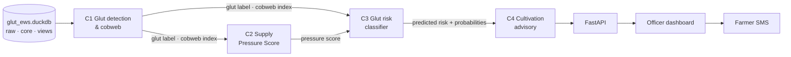

# Vegetable Glut Early Warning System — Team Guide

**Project:** J26-ISE-306 · ML-based Vegetable Glut Early Warning System for Sri Lankan Farmers
**Scope:** tomato · pumpkin · cucumber · winged bean · green chilli · 2018/19 Maha – 2025 Yala · 25 districts · 12 economic centres
**Project folder:** `glut-ews/` · dataset v1.0 · tooling v1.1


---

## 1. Team and ownership

| Component | Owner | Reads | Writes |
|---|---|---|---|
| C1 · Historical Glut Detection & Cobweb Analysis | G S Perera (IT23368552) | `views.component1_dataset` | `outputs.c1_glut_season` |
| C2 · Supply Pressure Assessment | Peiris M S A (IT23364042) | `views.component2_dataset` | `outputs.c2_pressure_score` |
| C3 · Glut Risk Prediction & Classification | Kudagama K E D M (IT23246782) | `views.component3_dataset` | `outputs.c3_risk_prediction` |
| C4 · Displacement-Aware Cultivation Advisory | Fernando J E (IT23267268) | `views.component4_dataset` | `outputs.c4_advisory` (new) |
| Parent schema & shared code | *assign one person* | all | `core.*`, `src/glut_ews/common`, `sql/views.sql`, runs `scripts/rebuild_db.py` |

Each owner is responsible for their module's preprocessing, model, explanations, evaluation and output table. Changes to `core.*` or `common/` go through the schema owner by pull request.



---

## 2. Project folder

```
glut-ews/
├── data/
│   ├── glut_ews.duckdb          parent dataset (schemas: raw, core, outputs, outputs_history, views)
│   ├── raw/source_manifest.csv  source files + SHA-256 fingerprints
│   ├── raw/sources/             original PDFs / Excel files (you copy them in; DVC-tracked)
│   ├── outputs/                 module outputs waiting to be loaded (publish_output writes here)
│   └── core_updates/            corrected / new core tables (schema owner only)
├── parquet/                     read-only exports of every table (regenerated by the rebuild)
├── sql/views.sql                definitions of the views (edit here, never in the database)
├── scripts/rebuild_db.py        loads outputs/core updates, re-applies views, checks, re-exports
├── src/glut_ews/
│   ├── common/                  db access · validate · split · lag · output contracts · publish
│   └── c1_glut_cobweb/ · c2_pressure/ · c3_risk/ · c4_advisory/   module code
├── notebooks/                   c1_01_eda.ipynb … c4_01_eda.ipynb (starter notebooks)
├── tests/                       keys, split, no look-ahead, publish → rebuild loop
├── docs/                        this guide · architecture diagram · datasheet · dictionary · known issues
├── api/ · dashboard/            delivery layer (to be built)
└── pyproject.toml · requirements.txt · .gitignore · .pre-commit-config.yaml
```

The database is the **source of truth**. `parquet/` and `csv_view/` are generated copies; never edit them, and read views from the database (`load("views.component3_dataset")`), not from `parquet/views` (a snapshot that only refreshes at the next rebuild).

---

## 3. Getting started (step by step)

### Step 1 — Repository setup (schema owner, once)
```bash
cd glut-ews
brew install uv libomp git                 # libomp is needed by XGBoost on macOS
uv venv --python 3.11 && source .venv/bin/activate
uv pip install -r requirements.txt && uv pip install -e .
pytest -q                                  # must show: 8 passed

git init && pre-commit install && nbstripout --install
dvc init
dvc add data/glut_ews.duckdb parquet
git add . && git commit -m "Project baseline: dataset v1.0, tooling v1.1"
git remote add origin https://github.com/<account>/glut-ews.git && git branch -M main && git push -u origin main
dvc remote add -d storage gdrive://<shared-google-drive-folder-id>
git commit -am "Add DVC remote" && git push && dvc push
```
Then copy the original source files into `data/raw/sources/` and track them: `dvc add data/raw/sources`, commit, `dvc push`, `git push`.

If Google shows "This app is blocked" on the first `dvc push`, create your own Google Cloud OAuth client and set it with `dvc remote modify storage gdrive_client_id …` (see the DVC Google Drive docs).

### Step 2 — Each member (once)
```bash
git clone https://github.com/<account>/glut-ews.git && cd glut-ews
brew install uv libomp
uv venv --python 3.11 && source .venv/bin/activate
uv pip install -r requirements.txt && uv pip install -e .
dvc pull
pre-commit install && nbstripout --install
pytest -q                                  # must show: 8 passed
```
In VS Code: install the **Python** and **Jupyter** extensions, then **Cmd + Shift + P → Python: Select Interpreter → `.venv`**.

### Step 3 — Explore your component's data
Open `notebooks/c3_01_eda.ipynb` (or your component's notebook), choose the `.venv` kernel and run all cells. The package is installed in editable mode, so `from glut_ews.common import load` works from any folder.

For eyeballing in Excel: `python scripts/rebuild_db.py --csv` writes `csv_view/` (viewing only; never edit or train on it).

### Step 4 — Work in your branch
```bash
git checkout -b c3-risk-model             # c1-…, c2-…, c3-…, c4-…
```
Notebooks: `notebooks/c3_02_preprocessing.ipynb`, `c3_03_model.ipynb`, …
Code that works moves into `src/glut_ews/c3_risk/` and is imported by the notebooks.

### Step 5 — Publish your module output (module owner)
```python
from glut_ews.common import publish_output
publish_output(result_df, "c3_risk_prediction", version="v1")
```
`publish_output` checks your table against its contract (`src/glut_ews/common/contracts.py`: columns, keys, allowed labels, ranges, probabilities summing to 1) and writes `data/outputs/c3_risk_prediction.parquet`. Then:
```bash
dvc add data/outputs/c3_risk_prediction.parquet
git add . && git commit -m "C3 v1 predictions" && dvc push && git push
```

### Step 6 — Rebuild the dataset (schema owner)
```bash
git pull && dvc pull
python scripts/rebuild_db.py --check-only  # validate pending files, change nothing
python scripts/rebuild_db.py               # apply, re-apply views, integrity checks, re-export parquet/
dvc add data/glut_ews.duckdb parquet && git add . && git commit -m "Rebuild: C3 v1" && dvc push && git push
```
The rebuild is all-or-nothing: if any file or integrity check fails, nothing changes. It backs up the database to `data/backups/` (last 3 kept), archives the replaced output version into `outputs_history.<table>`, and records active versions in `docs/build_manifest.json`. Close notebooks that hold the database open before running it.

Downstream owners then `git pull && dvc pull` and re-run.

**Core corrections (schema owner only):** put a full replacement table in `data/core_updates/<core_table>.parquet` (same columns as the existing core table, valid provenance values) and run the rebuild. Applied files move to `data/core_updates/applied/`.

---

## 4. Rules everyone follows

1. **One split** (`core.dim_season.split`): train ≤ 2023 Yala · validation 2023/24 Maha – 2024 Yala · test 2024/25 Maha – 2025 Yala. Never shuffle randomly. Use the test seasons only for final reporting.
2. **No look-ahead.** Features for season *t* use only information available before *t* starts. In the views, prices, arrivals, wastage, production, in-season weather and `historical_glut_label` describe season *t* itself; lag them with `lag_by_season(df, cols, ["district","crop"], k=1)`.
3. **Validate on load:** `validate(df, "core.supply_season")` fails loudly on bad keys or names.
4. **Missing values, outliers, scaling and lags are module decisions.** Core keeps real gaps as NULL (`provenance = 'missing'`).
5. **Report two results:** full dataset **and** observed subset (`provenance = 'observed'`). The observed-subset result is the stronger evidence for the panel and reviewers.
6. **C4 consumes predictions** (`outputs.c3_risk_prediction`), never the realised training label.
7. **Log every training run in MLflow** (parameters, metrics, dataset version, git commit), with fixed random seeds.
8. **Synthetic data is disclosed** in the methodology. The datasheet (`docs/DATASHEET.md`) has the wording and methods.

---

## 5. Component guides

### C1 · Historical Glut Detection & Cobweb Analysis — *G S Perera*

**Input:** `views.component1_dataset` (week × centre × crop), `core.national_supply_season`, `core.macro_monthly`

**Preprocessing**
- Real prices = nominal ÷ CCPI × 100; log-transform.
- Handle missing price weeks (NULLs): interpolate short gaps, mask long gaps.
- STL decomposition (trend / seasonal / residual) per crop × centre.

**Methods**
- Glut detection: residual anomaly (robust z-score) plus change-point detection (`ruptures`, PELT).
- Season label: Glut / No glut per season × centre × crop.
- Cobweb analysis: ADF/KPSS stationarity tests; Nerlove partial adjustment (area on lagged price and lagged area); district panel with fixed effects (`linearmodels`); Granger causality tests; cobweb stability (supply vs demand elasticity).
- Cobweb index per season × centre × crop.

**Explainability:** interpretable by design — explicit detection rules, regression coefficients with confidence intervals, and event plots.

**Output contract → `outputs.c1_glut_season`**

| Column | Type | Description |
|---|---|---|
| season, economic_centre, crop | key | |
| glut_weeks | int | harvest-window weeks flagged as glut |
| historical_glut_label | text | Glut / No glut |
| cobweb_index | float | lagged price → supply signal |
| source_version | text | v1 |

**Evaluation:** match detected events to documented gluts (news, HARTI reports); compare with the simple price-percentile baseline; threshold sensitivity; results on observed Colombo prices.

### C2 · Supply Pressure Assessment — *Peiris M S A*

**Input:** `views.component2_dataset` (season × district × crop) + C1 output

**Preprocessing**
- Build the 7 pre-planting indicators point-in-time: price incentive, target ratio, extent momentum, lagged profitability, lagged arrivals, pre-season rainfall, glut propensity.
- Check indicator correlations (OECD/JRC handbook); winsorise; min–max normalise.

**Methods (two tracks, reported side by side)**
1. Transparent composite index with entropy weights, plus weight-uncertainty bands (Monte Carlo, Saisana et al. 2005).
2. Calibrated score: logistic regression or calibrated classifier trained on C1 glut labels, scaled to 0–100.

**Explainability**
- Index: additive contribution of each indicator (weight × deviation).
- Calibrated score: **SHAP** values per prediction.
- Each row gets its top 3 drivers in plain words ("rising cultivated area", "high previous-season price").

**Output contract → `outputs.c2_pressure_score`**

| Column | Type | Description |
|---|---|---|
| season, district, crop | key | |
| supply_pressure_score | float | 0–100 |
| pressure_class | text | Low / Medium / High |
| top_drivers | text | top 3 SHAP / contribution drivers |
| source_version | text | v1 |

**Evaluation:** back-test the score against C1 gluts (ROC-AUC, Spearman); compare the integrated score with single indicators; expert review of weights.

### C3 · Glut Risk Prediction & Classification — *Kudagama K E D M*

**Input:** `views.component3_dataset` (season × district × crop, includes `split`) + C1 and C2 outputs

**Preprocessing**
- Lag all same-season outcome columns by one season.
- Exclude `production_t`, harvest prices/arrivals of season *t* and the realised label inputs from features.
- Encode crop, district and season type.

**Methods**
- Baselines first: majority class, "same as last season", logistic regression.
- Then XGBoost with limited Optuna tuning (about 1,500 rows; keep the search small).
- Class imbalance: class weights; SMOTE only inside training folds if used.
- Rolling-origin temporal validation (train ≤ *t*, test *t+1*).
- Probability calibration (isotonic).

**Explainability:** **SHAP TreeExplainer**, giving global feature importance plus a per-prediction explanation converted into a plain-language reason (e.g. "High risk: cultivated area 25% above average, strong price last season, glut-prone Maha harvest").

**Output contract → `outputs.c3_risk_prediction`**

| Column | Type | Description |
|---|---|---|
| season, district, crop | key | |
| predicted_risk_label | text | Low / Medium / High |
| prob_low, prob_medium, prob_high | float | calibrated probabilities |
| top_reasons | text | SHAP-based plain-language reasons |
| source_version | text | v1 |

**Evaluation:** macro-F1, recall on High, PR-AUC, confusion matrix, bootstrap confidence intervals; observed-subset results; validate High predictions against documented glut events; expert review of explanations.

### C4 · Displacement-Aware Cultivation Advisory — *Fernando J E*

**Input:** `views.component4_dataset` + `outputs.c3_risk_prediction` (predictions, not labels)

**Methods**
- MOTAD linear programme (Hazell 1971) with PuLP (CBC) or OR-Tools: maximise expected gross margin minus risk.
- Constraints: district land, national demand cap (anti-glut), crop bounds tightened for predicted High-risk crops.
- Alternative crops: for "reduce" advice, rank suitable lower-risk crops by expected margin.
- Sensitivity analysis on risk aversion (λ), demand cap and land limit.

**Explainability:** the optimiser itself isn't explained with SHAP. Explanations come from:
1. **Reason codes** carried over from C3's SHAP drivers.
2. **Binding constraints and shadow prices** — which limit drove the recommendation (e.g. "national tomato demand cap reached").
3. **What-if comparisons** (recommendation with vs without the risk adjustment).

Every SMS and dashboard item carries a one-line reason.

**Output contract → `outputs.c4_advisory`**

| Column | Type | Description |
|---|---|---|
| plan_season, district, crop | key | |
| recent_avg_extent_ha | float | baseline |
| recommended_ha | float | optimiser output |
| change_pct | float | vs baseline |
| action | text | Reduce / Maintain / Expand |
| suggested_alternatives | text | crops |
| explanation | text | reason codes + binding constraint |
| source_version | text | v1 |

**Evaluation:** historical back-test (would following the plan have reduced glut-season area?); officer review of quantities and explanations; SUS usability survey (target ≥ 68); SMS delivery rate.

---

## 6. Explainable AI summary

| Component | Model type | Explainability method | What the officer sees |
|---|---|---|---|
| C1 | Statistical rules + regression | Interpretable by design (rules, coefficients, event plots) | "Glut in 2023 Yala at Dambulla: price 35% below normal for 5 weeks" |
| C2 | Composite index + calibrated scorer | SHAP + additive indicator contributions | "Pressure 78/100 — main drivers: rising cultivated area, high previous-season price" |
| C3 | XGBoost classifier | SHAP TreeExplainer → plain-language reasons | "High risk — area 25% above average; glut-prone season" |
| C4 | MOTAD optimisation | Reason codes from C3 SHAP + binding constraints + what-if | "Reduce tomato by 20% in Badulla — high predicted risk; national demand cap reached; consider pumpkin" |

Validate the explanations with agricultural experts (proposal: "explainability check").

---

## 7. Placeholder replacement order

The outputs tables currently hold `placeholder_v0` data so all four modules can start in parallel (see `docs/placeholder_realism_report.md`). Replace them **upstream first**:

1. **C1 v1** → C2 and C3 re-run on real C1 outputs
2. **C2 v1** → C3 re-runs
3. **C3 v1** → C4 re-runs
4. **C4 v1** → API and dashboard

Each rebuild archives the replaced version in `outputs_history`, so each owner can report metrics on v0 and on v1 inputs. A planned **error-propagation study** — flip 5/10/20% of C1 labels and measure C3/C4 degradation — makes a strong section for the paper.

---

## 8. Suggested phases

| Phase | Weeks | Work |
|---|---|---|
| 0 · Setup | 1 | Repository, DVC, environments, `pytest` passing for everyone |
| 1 · EDA & preprocessing | 2–3 | Each module explores its view and writes preprocessing in `src/` |
| 2 · Baselines on placeholders | 4–6 | Baselines, first models, explanations, MLflow logging |
| 3 · Replace placeholders | 7–9 | C1 → C2 → C3 → C4, re-run downstream |
| 4 · Integration | 8–11 | FastAPI endpoints, React dashboard, SMS gateway |
| 5 · Evaluation & paper | 10–12 | Observed-subset results, expert validation, SUS, write-up |

**In parallel (real data acquisition, replaces synthetic parts):**
- HARTI weekly bulletins: multi-market and producer prices (suggested: C1 owner).
- Remaining Crop Forecast district tables, image-only bulletins (suggested: C2 owner).
- Dambulla arrivals via RTI request (suggested: C4 owner).
- Official monthly CCPI from DCS (schema owner).

---

## 9. System integration (delivery)

- **FastAPI** endpoints (read from `outputs.*`): `/glut-history`, `/pressure-score`, `/risk`, `/advisory`, each returning values **with their explanations**.
- **React dashboard** for agricultural officers: district map, risk table, drivers, recommended quantities, approve/edit advice.
- **SMS gateway:** officer-approved messages (≤ 160 characters, with reason), delivery logging.

---

## 10. Publication checklist

- [ ] Evaluation protocol (split, metrics, baselines, glut definition) written down before final results
- [ ] Observed-subset results reported alongside full-data results
- [ ] Synthetic data disclosed in the methodology (wording in `docs/DATASHEET.md`)
- [ ] Threshold and parameter sensitivity analyses
- [ ] Bootstrap confidence intervals; strong simple baselines
- [ ] Explanations validated with agricultural experts
- [ ] Code + dataset version released (Git tag + DVC version)
- [ ] Data-use permissions checked for HARTI / DOA / DCS sources

---

## 11. Reference

| Document | Location |
|---|---|
| Project README | `README.md` |
| Dataset README | `docs/DATASET_README.md` |
| Datasheet (sources, synthetic methods, limitations) | `docs/DATASHEET.md` |
| Column definitions | `docs/data_dictionary.csv` |
| Source defects and handling | `docs/known_issues.csv` |
| Model parameters and sources | `docs/model_parameters.csv` |
| Placeholder realism report | `docs/placeholder_realism_report.md` |
| Source files and fingerprints | `data/raw/source_manifest.csv` |
| Architecture diagram | `docs/architecture_flowchart.png` / `.svg` |
| Output contracts | `src/glut_ews/common/contracts.py` |
| View definitions | `sql/views.sql` |
| Build manifest (active versions) | `docs/build_manifest.json` |

**Provenance values:** `observed` (published source) · `estimated` (deterministic derivation from observed data) · `synthetic` (documented model with assumptions and random variation) · `missing` (not collected at source).
